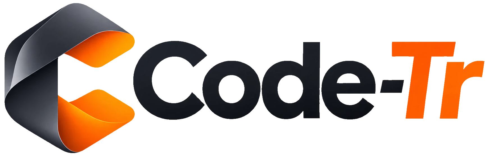

<p align="center">
  <picture>
    <source media="(prefers-color-scheme: dark)" srcset="brand/wordmark-dark.png">
    
  </picture>
</p>

<p align="center"><b>Ücretsiz, Türkçe yapay zekâ asistanı</b> — sohbet et, kod yazdır, PDF özetlet, görsel üret.</p>
<p align="center"><a href="https://coder-tr.vercel.app"><b>coder-tr.vercel.app</b></a> · <a href="https://coder-tr.vercel.app/hakkinda.html">Hakkında</a> · <a href="LICENSE">MIT</a></p>

---

## Neden?

Güçlü yapay zekâ araçlarının çoğu ücretli, İngilizce ya da kredi kartı istiyor. Code-Tr, dünyadaki ücretsiz modelleri tek bir sade, Türkçe arayüzde toplar: öğrenciler, küçük işletmeler ve yazılıma yeni başlayanlar için.

## Özellikler

- **Sohbet** — akarak gelen cevaplar, Markdown ve renkli kod blokları
- **Kod** — kod yazar; klasör seçersen dosyaları okur, düzenler (yazma ve komutlar onay ister)
- **Editör** — Kod modunda dosya ağacı, sekmeli editör (CodeMirror 6), HTML projeleri için canlı önizleme. Chrome/Edge'de (Windows, Mac) bilgisayardaki klasör doğrudan açılır; telefon, tablet, Safari ve Firefox'ta projeler tarayıcıda saklanır, içe/dışa aktarılır. Ajanın her değişikliği önce satır satır fark olarak gösterilir, onaylanmadan diske yazılmaz
- **Yayınla** — Netlify ile tek tıkla (kullanıcının kendi hesabıyla; izin anahtarı yalnız sekme belleğinde durur), ya da zip + Netlify/Vercel/Cloudflare Drop, GitHub Pages. `sitemap.xml` ve `robots.txt` otomatik eklenir; Google Search Console rehberi içinde
- **Her cihazda** — Windows, Mac, Android, iPhone ve iPad'e uygulama olarak yüklenir (PWA); Mac için ayrıca yerel modelli uygulama
- **Görsel** — yazdığını ücretsiz görsele çevirir (kare, dikey, yatay, gönderi)
- **Ekler** — görsel, PDF (taranmış PDF dahil) ve metin dosyaları
- **Hesaplar** — e-posta/şifre ya da Google ile giriş; sohbetler her cihazda
- **Hızlı ve dayanıklı** — bir model meşgulse anında başka ücretsiz modele geçer
- **Mac uygulaması** — Ollama ile internetsiz, yerel modellerle de çalışır
- **Gizlilik** — KVKK aydınlatma metni, tek tıkla hesap ve veri silme

## Yapı

```
web/
  index.html        Arayüz (tek dosya; web ve Mac sürümü ortak)
  server.py         Mac uygulamasının yerel sunucusu (yalnızca Python standart kütüphanesi)
  api/              Vercel sunucu fonksiyonları
    chat.js         OpenRouter vekili: yalnızca ücretsiz modeller, yedek modellere yarış
    models.js       Ücretsiz model listesi
    auth.js         Kayıt / giriş / hesap (PBKDF2 şifreleme, HttpOnly oturum çerezi)
    chats.js        Sohbet eşitleme
    google.js       Google ile giriş (OAuth 2.0)
    contact.js      İletişim formu
    config.js       Arayüz ayarları (paylaşılan model, hesaplar, Netlify istemci kimliği)
  yayin-giris.html  Netlify girişinin döndüğü sayfa (anahtarı yalnız açık sekmeye iletir)
  legal/            Hakkında, Gizlilik/KVKK, Kullanım Şartları
  version.json      Sürüm ve "Yenilikler" notları
mac/                Mac uygulaması başlatıcısı ve simge
mac/ide/entry.js    Editör paketi girişi (CodeMirror 6 + fflate); build.sh tek dosyaya paketler
build.sh            Mac uygulamasını ve web sitesini üretir
```

## Kendi sunucunda çalıştır

1. Bu depoyu klonla ve `./build.sh` çalıştır; `site/` klasörü oluşur.
2. `site/` klasörünü Vercel'e yükle (`vercel deploy --prod`).
3. Vercel ortam değişkenleri:
   - `OPENROUTER_API_KEY` — [openrouter.ai/keys](https://openrouter.ai/keys) (ücretsiz)
   - Upstash Redis entegrasyonu (`KV_REST_API_URL`, `KV_REST_API_TOKEN`) — hesaplar için
   - İsteğe bağlı: `GOOGLE_CLIENT_ID`, `GOOGLE_CLIENT_SECRET` — Google ile giriş
   - İsteğe bağlı: `NETLIFY_CLIENT_ID` — "tek tıkla yayınla". [app.netlify.com/user/applications](https://app.netlify.com/user/applications) → *New OAuth app*, yönlendirme adresi `https://SENIN-ALANIN/yayin-giris.html`. Yalnız istemci kimliği gerekir (gizli anahtar kullanılmaz). Boş bırakılırsa sürükle-bırak seçenekleri kalır

## Mac uygulaması

`./build.sh install` → `/Applications/Code-Tr.app`. Yerel modeller için [Ollama](https://ollama.com) kurulu olmalı. Uygulama imzasız olduğundan ilk açılışta sağ tık → **Aç**.

## Yazı tipi

[Manrope](https://fonts.google.com/specimen/Manrope), SIL Open Font License 1.1.

## Lisans

[MIT](LICENSE) © 2026 Code-Tr
